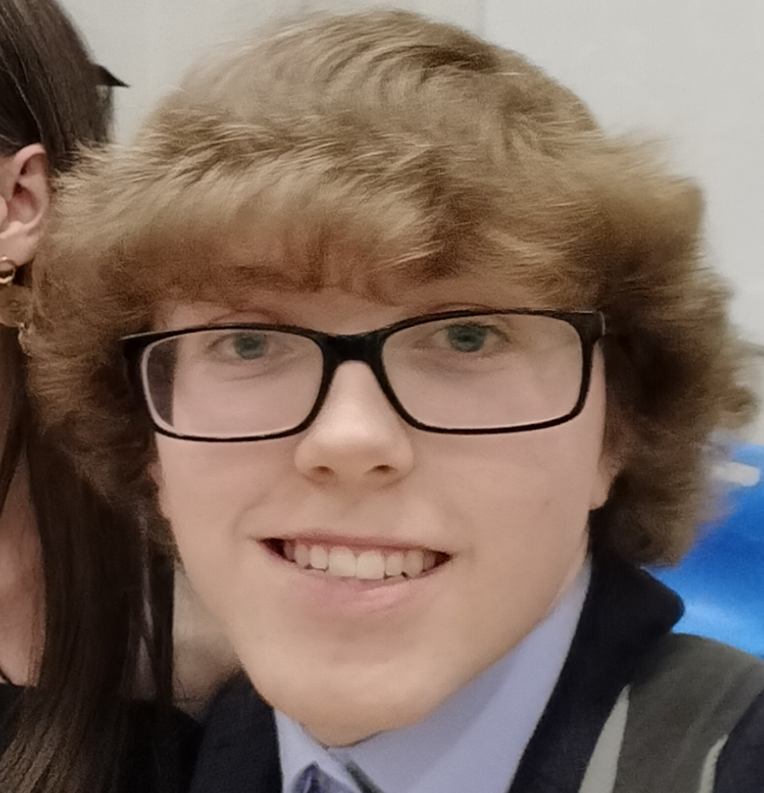



<h2>{{ page.title }}</h2>

Contact me:

<a href="www.linkedin.com/in/charles-duffy-dhenain-ise/"> LinkedIn </a> ***
<a href="www.github.com/Charlie-duf"> GitHub </a> ***
<a href="mailto:26432684@studentmail.ul.ie">Email me</a>
<a href="[/files/report.pdf](Charles_Duffy_Dhenain_CV.pdf)" download>Download my CV</a>

About Me:

First year Immersive Software Engineering student at University of Limerick (589 CAO).
Hands-on experience in Python, Java, GitHub, and AWS deployment.
Experienced project lead and organiser with a track record of coordinating teams, managing events, and delivering practical technical projects.

<h4>Technical Skills: </h4>
Coding languages: Python, Java, HTML, and C++ (basic).
Familiar with the typical DevOps cycle as well as Git and GitHub.
Spoken languages: English (fluent), French (fluent), Irish (conversational), Spanish (conversational).

Education:
University of Limerick (Sept 2026 – present) - Bachelor/Master of Science in Immersive Software Engineering.
    • Skills learned: 	Java, DevOps, Computer Organisation, Git.
      
Luttrellstown Community College (2020 - 2026) - QQI level 5, CAO: 589

    • Subjects: 		Computer Science, Maths, English, Irish, French, Spanish, Biology, Business.

